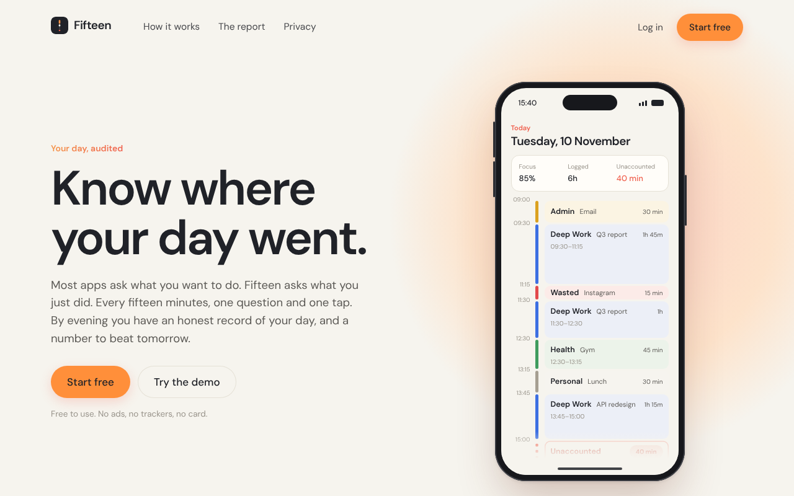
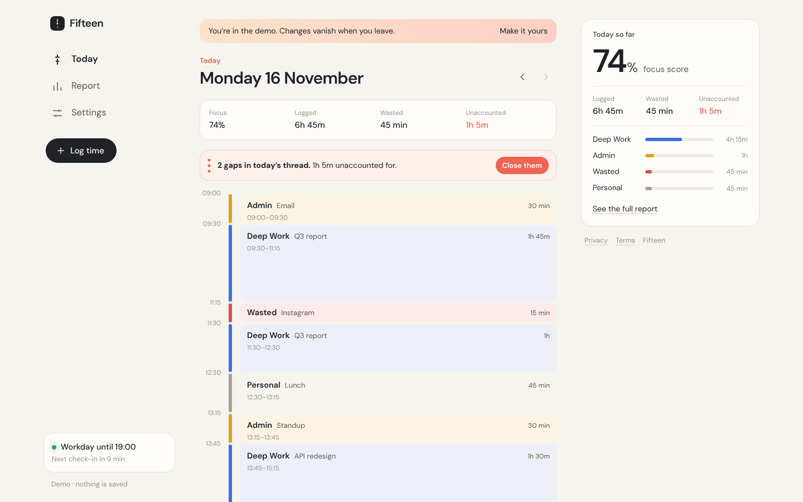

# Fifteen

Your day, audited.

Most apps ask what you want to do. Fifteen asks what you just did. Every fifteen minutes it checks in, you
tap one of four categories, and the answers build a timeline of your day: a single thread that takes the
colour of whatever you were doing, and breaks into dots wherever you didn't answer. In the evening you get
a report with a focus score, the time you wasted, and how today compares with the same day last week.





## What's in the box

- **The thread.** A vertical timeline of the day. Neighbouring check-ins merge into blocks; tap one to change it.
- **Check-ins.** A sheet with your four most-used categories. Hold a category to add a tag such as "Gym".
- **Gaps.** Tracked time you didn't account for shows as a dotted stretch, and counts against your score.
- **Suggestions.** The likely answer is marked, based on what you were just doing and what you usually do
  at that hour. It is worked out from your own history; a website can't see your other apps or where you are.
- **Daily report.** Focus score, burn rate ("You wasted 1.5 hours today. That is 9% of your waking day.")
  and a trend against the same weekday last week.
- **Your schedule.** Track on demand, or automatically during your workday. Pick the check-in interval and
  the time your day ends, so a shift that runs to 2 am stays on one day.
- **Accounts.** Email and password, a recovery code instead of reset emails, export everything as JSON,
  delete everything with one button.
- **A demo** at `/demo` that runs entirely in the browser.

## How it's built

One Cloudflare Worker serves both the site and the API.

| Part | What it is |
| --- | --- |
| `src/` | The web app: React and plain CSS, built with Vite |
| `worker/` | The API, written with [Hono](https://hono.dev) |
| `shared/` | Time, scoring and gap logic used by both sides |
| `migrations/` | The D1 (SQLite) schema |
| `public/sw.js` | Service worker that shows check-in notifications |
| `test/` | API and logic tests (Vitest, against a real local D1) |

## Run it locally

You need Node 22 or newer.

```bash
npm install
```

```bash
npm run db:migrate:local
```

```bash
npm run dev
```

The app is then at http://localhost:5173. Other commands:

```bash
npm test
```

```bash
npm run typecheck
```

## Deploy to Cloudflare

Everything here fits the free plan.

1. In the Cloudflare dashboard open **Workers & Pages → Create → Import a repository** and pick this repository.
2. Name the project `fifteen` (it has to match `name` in `wrangler.jsonc`).
3. Set the build command to `npm run build` and the deploy command to `npm run deploy`.
   The deploy command applies any new database migrations first, then publishes the Worker.
4. Deploy. The site comes up on a `workers.dev` address.

The database is already named in `wrangler.jsonc`. If you are deploying your own copy, create one with
`npx wrangler d1 create fifteen` and put its id in that file. A database id is not a secret.

If the deploy step fails on the migration with a permissions error, the build's API token is missing D1
access: create a token that includes **D1 → Edit** and select it under the project's build settings.

To use your own domain, open the Worker's **Settings → Domains & Routes → Add → Custom domain**. Nothing in
the code needs to change.

### Bot protection (recommended)

Sign-up, log-in and recovery are rate limited out of the box. For a real launch, also switch on
[Turnstile](https://developers.cloudflare.com/turnstile/), which is free:

1. Create a Turnstile widget for your domain in the Cloudflare dashboard.
2. Put the **site key** in `wrangler.jsonc` under `vars.TURNSTILE_SITE_KEY`. It is public.
3. Add the **secret key** as a secret named `TURNSTILE_SECRET`, in the Worker's settings or with:

```bash
npx wrangler secret put TURNSTILE_SECRET
```

The check appears on the forms only when both are set.

### Notifications when the app is closed (optional)

Without any setup, check-ins appear while Fifteen is open in a tab. To have them arrive when it is closed:

```bash
npm run vapid
```

That prints a public key for `wrangler.jsonc` and a private key to store as the `VAPID_PRIVATE_KEY` secret.
Pushes are sent empty; the browser then asks Fifteen what to show, so nothing about anyone's day passes
through a push service. On iPhone, notifications need the site added to the Home Screen first.

### Staying inside the free plan

- Workers: 100,000 requests a day. Static files don't count.
- D1: 5 GB and 100,000 row writes a day. A check-in is one write.
- The once-a-minute cron uses 1,440 requests a day and does nothing until push keys are set.
- Each cron run can send about 40 notifications. That is the first limit a growing user base would hit.

## Before you launch

- Replace the placeholder contact address in `shared/site.ts`.
- Fill in the two bracketed placeholders in the privacy policy and terms (`src/pages/legal/`): who runs the
  service and their postal address, and the governing law. The texts were written to match what the code
  does, but they are not legal advice. Have them checked if you can.
- Turn on Turnstile.

## Security

No secrets belong in this repository. Public values live in `wrangler.jsonc`; secrets are set in Cloudflare.
Before every push, scan the full history:

```bash
npm run scan
```

To make that automatic, install [gitleaks](https://github.com/gitleaks/gitleaks#installing) and enable the
hook once per clone:

```bash
git config core.hooksPath .githooks
```

CI runs the same scan, plus the tests, on every push. See [SECURITY.md](SECURITY.md) for how accounts are
protected and how to report a problem.
